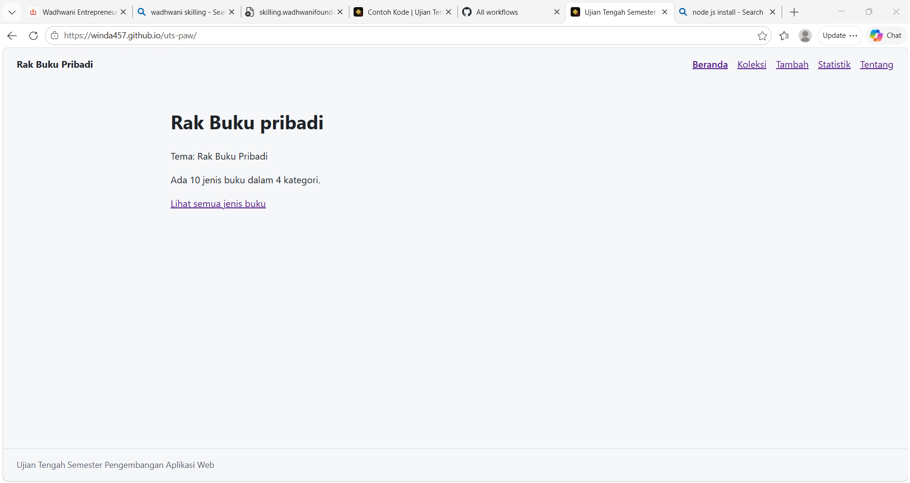
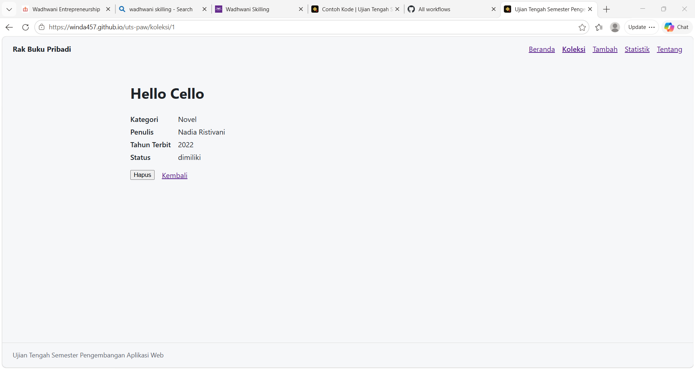
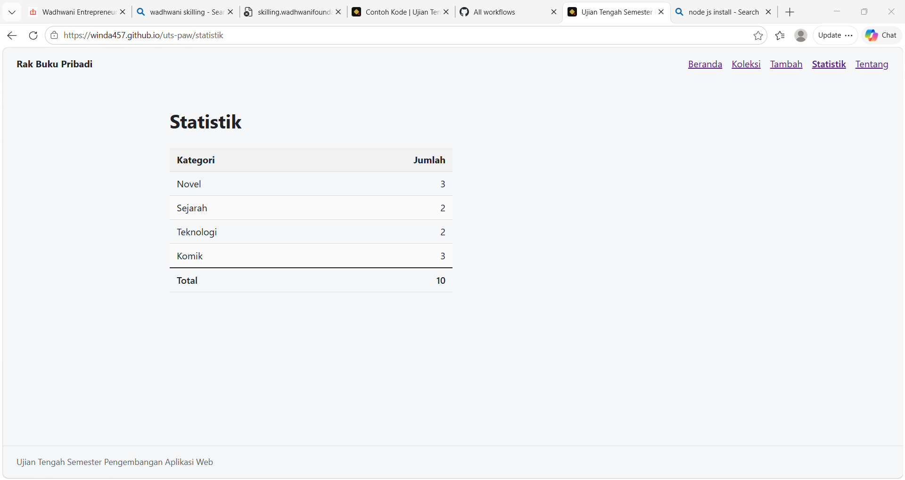
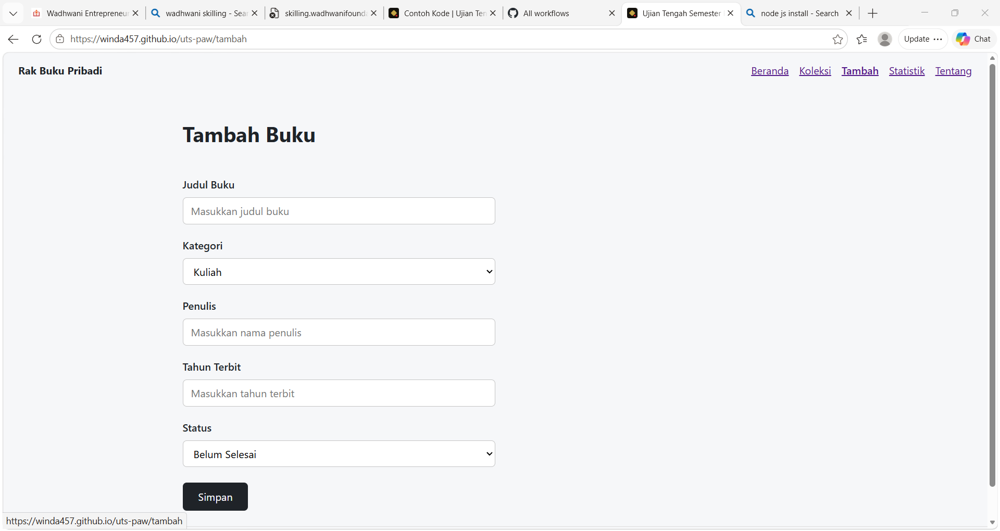
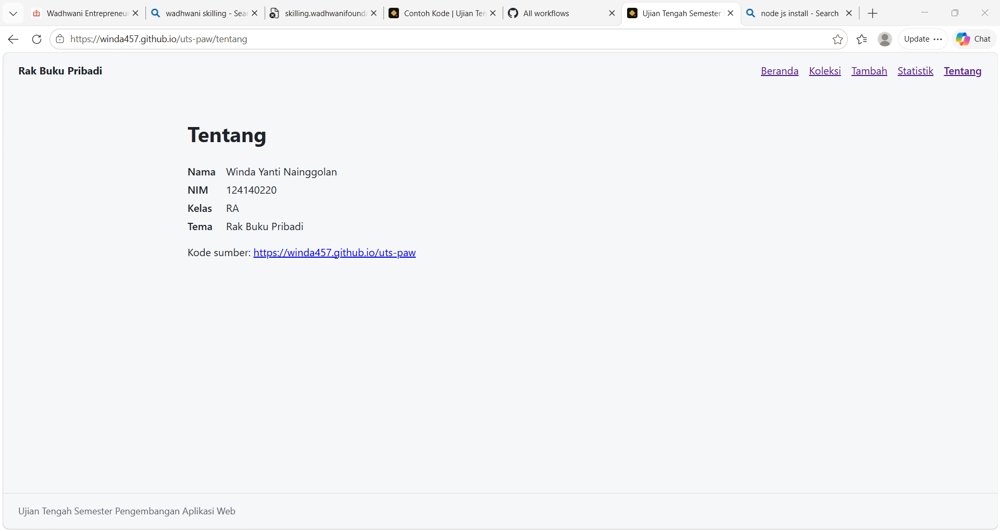

# Ujian Tengah Semester IF25-22014 Pengembangan Aplikasi Web

Repo induk Ujian Tengah Semester Pengembangan Aplikasi Web, Informatika ITERA, semester ganjil 2026/2027.

**Soal, contoh kode, panduan, rubrik, ketentuan, dan materi: https://uts-paw.mhabibalgifari.web.id**

| 
## README milikmu

Ganti seluruh isi berkas ini dengan dokumentasi aplikasimu (butir rubrik A4). Kerangka berikut boleh dipakai:

```markdown
# Nama Aplikasi

Nama: Winda Yanti Nainggolan
NIM: 124140220
Kelas: RA
Tema: Rak Buku Pribadi
Deployment: https://winda457.github.io/uts-paw/













## Fitur

- Menampilkan halaman beranda aplikasi.
- Menampilkan daftar koleksi.
- Mencari koleksi berdasarkan judul.
- Menampilkan detail setiap koleksi.
- Menambahkan data koleksi baru.
- Menghapus data koleksi.
- Menampilkan statistik jumlah koleksi berdasarkan kategori.
- Menampilkan informasi nama dan NIM pembuat aplikasi.
- Menampilkan halaman 404 jika halaman tidak ditemukan.
- Menyimpan data baru menggunakan localStorage.

## Menjalankan secara lokal

cd app
npm install
npm run dev

## Konsep React yang dipakai

- Component: Membagi tampilan aplikasi menjadi beberapa bagian.
- Props: Mengirimkan data antar komponen.
- useState: Mengelola perubahan data.
- useEffect: Menjalankan proses ketika komponen ditampilkan atau data berubah.
- Context API: Membagikan data ke beberapa komponen.
- Custom Hook: Membuat fungsi hook sendiri.
- React Router: Mengatur perpindahan halaman.
- useParams: Mengambil parameter dari URL.
- useNavigate: Melakukan navigasi halaman.
- NavLink dan Link: Membuat tautan antarhalaman.
- Fetch API: Mengambil data dari file JSON.
- Async/Await: Mengatur proses pengambilan data.
- Conditional Rendering: Menampilkan halaman sesuai kondisi.
- Array Method: Menggunakan map, filter, dan reduce untuk mengolah data.
```
